# VISUAL-FLOWS — Full Lifecycle, Scenarios, and Efficiency

**Status:** Draft — supporting  
**Version:** 0.1.0  
**Date:** 2026-11-03  
**Authority:** None. Structure only.  
**Canonical parent:** SPEC-001

Diagrams use Mermaid. They illustrate structure and possible paths. They do not constitute approval or empirical proof.

---

**Static image versions** (also in `docs/images/`):

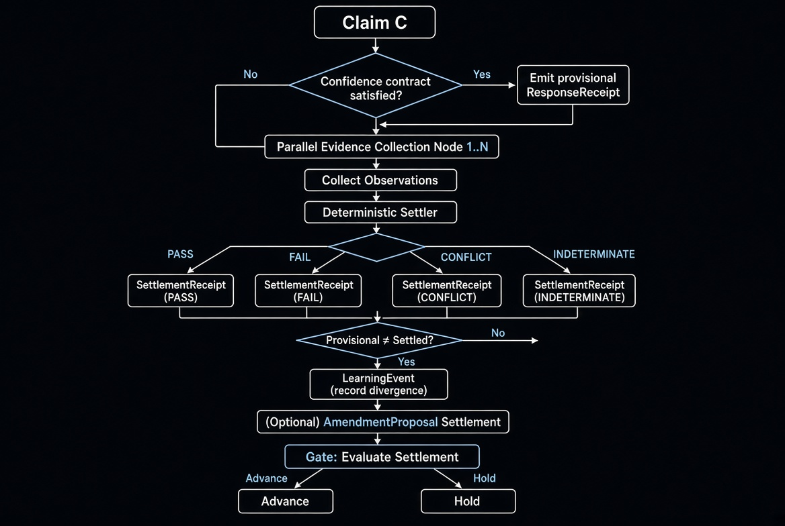

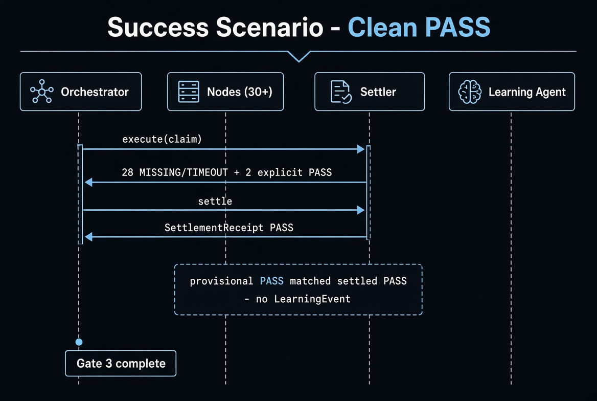

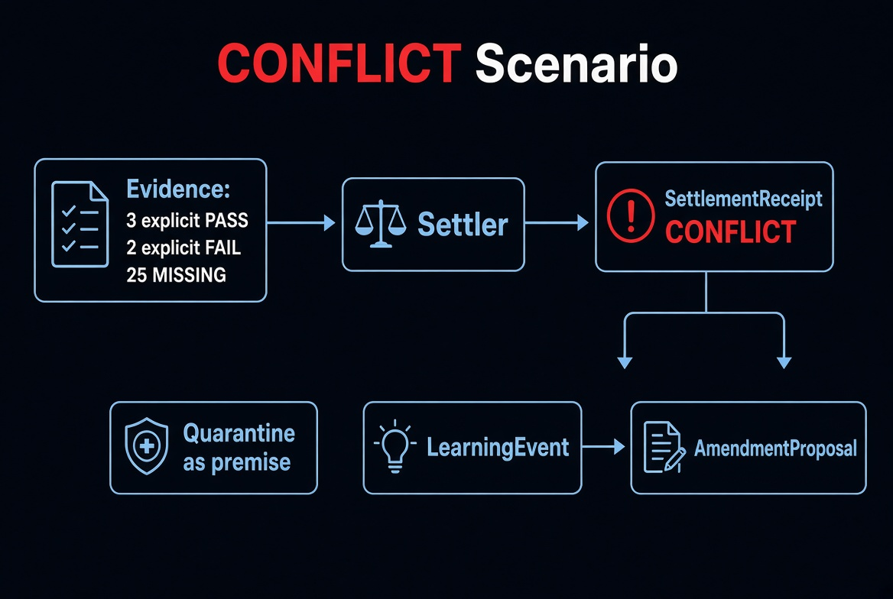

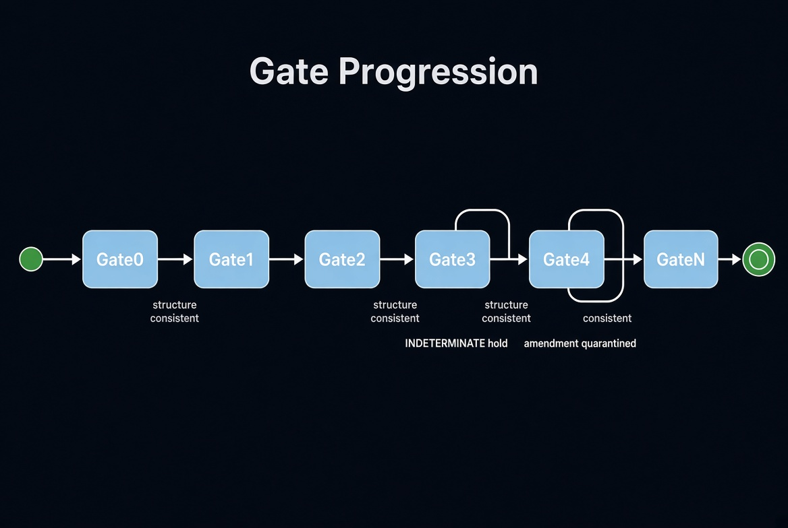

---

## 1. Full Lifecycle Overview

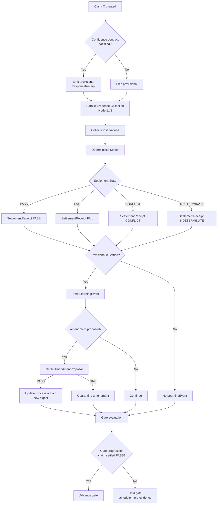

---

## 2. Success Scenario — Clean PASS

**Example claim:** “Gate 3 minimum of 30 response receipts is sufficient for stub demonstration.”

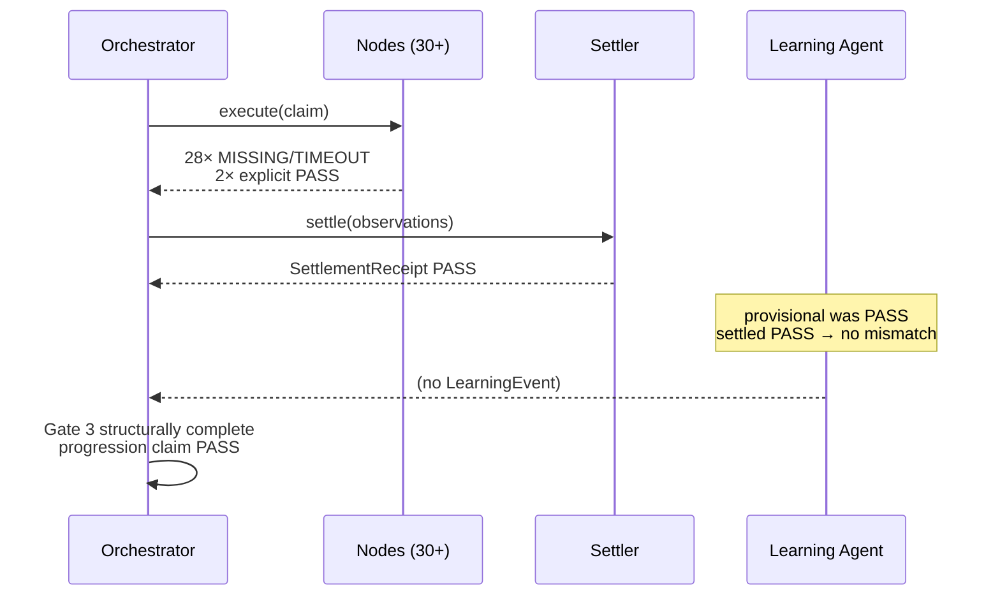

**Outcome:** Settlement PASS, no LearningEvent, gate may advance.  
**Efficiency note:** High explicit-evidence yield relative to nodes run.

---

## 3. Failure Scenario — Explicit FAIL

**Example claim:** “Stub nodes alone prove production readiness.”

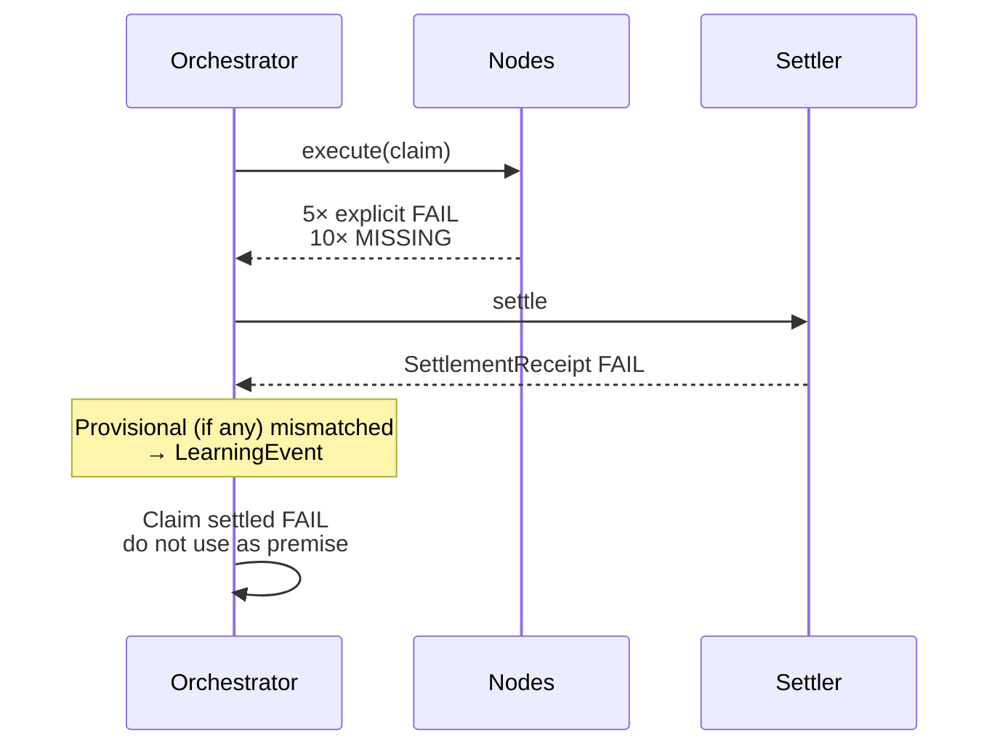

**Outcome:** Settlement FAIL. Claim quarantined as premise. LearningEvent may propose tighter Gate 3 criteria or additional required evidence.  
**Efficiency note:** Early FAIL with few nodes is cheap; avoids wasted downstream work.

---

## 4. CONFLICT Scenario — Mixed Explicit Evidence

**Example:** Stacy/Stephanie-style competing observations on the same claim.

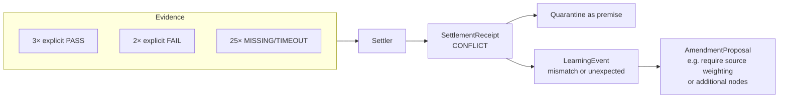

**Outcome:** CONFLICT. Neither side erased. Both receipts remain. Claim cannot be used as a settled premise until resolved by further evidence or explicit policy.  
**Efficiency note:** CONFLICT is informative; it surfaces the need for better evidence or refined criteria rather than silent error.

---

## 5. INDETERMINATE Scenario — Insufficient Explicit Evidence

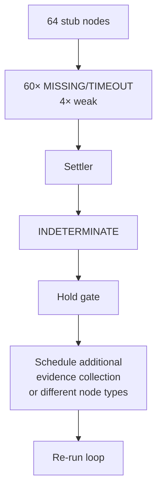

**Outcome:** INDETERMINATE. Gate held. Process remains correct; more evidence required.  
**Efficiency note:** Cheap to detect. Prevents false progression.

---

## 6. Self-Adjustment Success Path

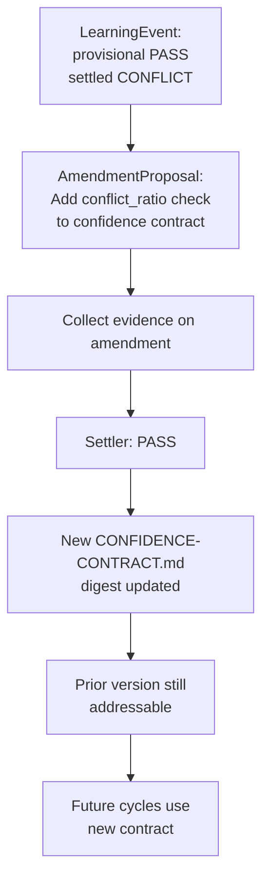

**Outcome:** Process improved via settled amendment. History preserved.  
**Efficiency metric candidate:** Number of settled amendments that reduce future CONFLICT or INDETERMINATE rate.

---

## 7. Self-Adjustment Hold / Quarantine Path

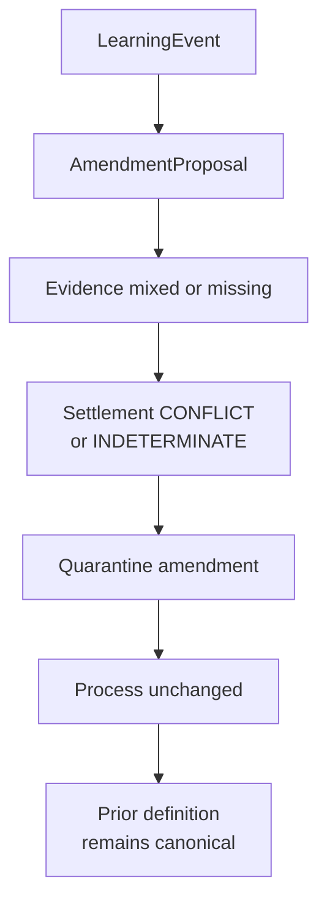

**Outcome:** No mutation. Unresolved proposal isolated.  
**Efficiency note:** Prevents thrashing from low-evidence amendments.

---

## 8. Gate Progression Flow

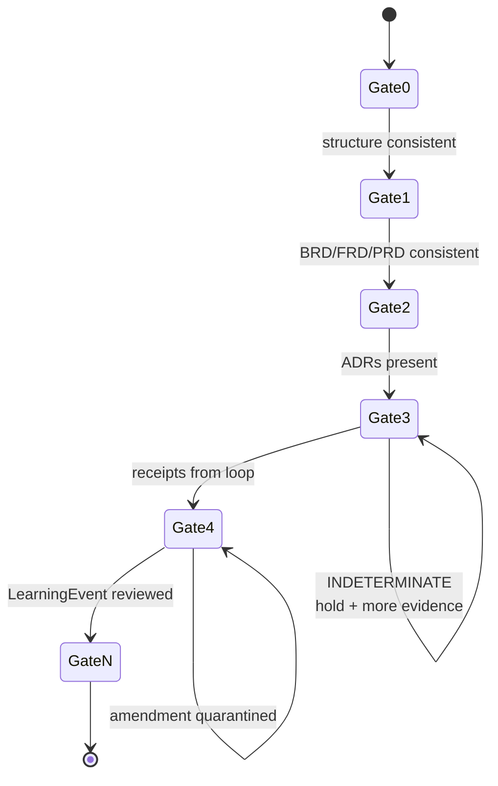

---

## 9. Efficiency Metrics (structural candidates)

These are measurable from receipts. They are not settled success criteria.

| Metric | Definition | Desired direction | Source |
|--------|------------|-------------------|--------|
| Explicit yield | explicit observations / total observations | Higher (for informative claims) | SettlementReceipt |
| Conflict rate | CONFLICT settlements / total settlements | Lower over time (via amendments) | SettlementReceipt |
| Mismatch rate | LearningEvents / provisional answers | Lower after process amendments | LearningEvent |
| Hold duration | cycles spent in INDETERMINATE before PASS/FAIL | Lower | OrchestrationReceipt |
| Amendment success | settled PASS amendments / proposals | Context-dependent | Amendment settlement |
| Recoverability | prior digests still resolvable | 100% | Content-addressed store |
| Stub-to-extension | Gate 3 passed with stubs only | Yes for early gates | GATE-3 checklist |

Metrics themselves may become claims and be settled or quarantined.

---

## 10. Concrete End-to-End Example (Stub)

1. Claim: “30 stub nodes suffice for Gate 3 structural evidence.”
2. Run `python3 sketch.py` (64 nodes).
3. Observe ~8 PASS, ~4 FAIL → Settlement CONFLICT.
4. LearningEvent emitted (provisional may have been PASS or null).
5. AmendmentProposal: “Raise Gate 3 explicit-yield minimum or add conflict tolerance note.”
6. Amendment settled INDETERMINATE (no further evidence) → quarantined.
7. Gate 3 held. Process definition unchanged. All receipts addressable.

This demonstrates the full lifecycle without any production components.

---

**Disposition:** Visual and scenario structure only. Paths shown are illustrative. Actual settlement depends solely on explicit evidence.
